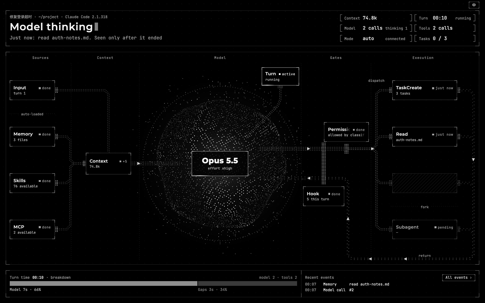
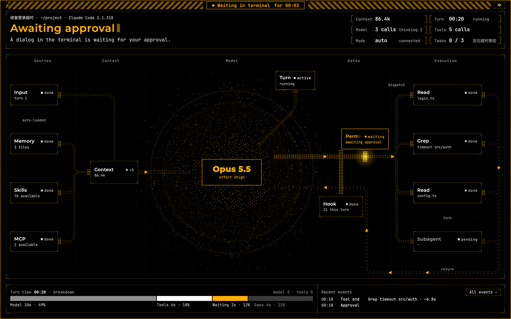
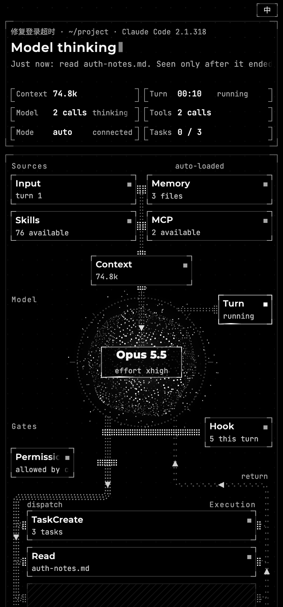

# harness-board

**A live view of what Claude Code is doing right now.** Type `/harness-board` in a Claude Code session and a local page opens in your browser. While Claude works, the page lights up each step as it happens: your prompt coming in, context being assembled, model calls, permission checks and hooks, tool calls, subagents, and the end of the turn.

[中文说明](README.zh-CN.md)



> Screenshots in this README come from the page's built-in demo replay (made-up data). The session title is shown exactly as it was typed, so it can be in another language.

## What you see

The page has three parts:

- **Now.** One plain sentence about what Claude Code is doing right now, such as "Model thinking", "Awaiting approval" or "Turn ended", plus six readings: context size and compactions, turn time, model calls, tool calls, permission mode and connection state, and task-list progress when one is in use.
- **The flow.** Sources (your input, plus memory, skills and MCP loaded automatically) → context → model → gates (permission, hooks) → execution (tools, subagents). The path that is active right now has particles moving along it. When tools finish, the flow loops back to the model, and the counter shows how many times this has happened.
- **Record.** Where this turn's time went (model, tools, waiting for you, gaps) and the latest events. Click any card, or **All events**, to open a drawer with the details.

Colors have fixed meanings. **Amber** means Claude Code is waiting for you, for example an approval dialog in the terminal. **Red** means a step did not complete as planned: it failed, was denied, or you pressed Esc. **Gray, frozen** means the connection was lost or Claude Code has exited.



The layout rearranges itself for wide, regular, half-screen and narrow windows; it does not just scale down. A button in the top-right corner switches the page between English and Chinese. By default the page follows your browser's language.



## Requirements

- **macOS**, with Claude Code running **in a terminal**. Linux may work but is untested. Windows is not supported: the script refuses to run there.
- **Claude Code 2.1.69 or later.** The record parser has been checked against Claude Code 2.1.258 to 2.1.322.
- **`python3`, version 3.9 or later.** Only the standard library is used, so there is nothing to `pip install`. On macOS, `python3` comes with the Command Line Tools: run `xcode-select --install` if it is missing.
- A browser.

This is **not** for the Claude desktop or web chat apps, and not for Claude Code cloud sessions. The page reads the session records that Claude Code writes on your own machine, and those apps don't write them there.

## Install

```bash
git clone https://github.com/Zhiheng-07/harness-board.git
mkdir -p ~/.claude/skills
cp -R harness-board/harness-board ~/.claude/skills/
```

Copy the **inner** `harness-board` folder (the one that contains `SKILL.md`). You should end up with `~/.claude/skills/harness-board/SKILL.md`.

- If you set `CLAUDE_CONFIG_DIR`, copy the folder to `"$CLAUDE_CONFIG_DIR/skills/"` instead.
- You can also download the zip from [Releases](https://github.com/Zhiheng-07/harness-board/releases). It unpacks to a `harness-board/` folder; move that folder into `~/.claude/skills/`. Each release lists the zip's SHA-256.

Then start a new Claude Code session.

## Use

| What | How |
|-|-|
| Open the board | Type `/harness-board` in a Claude Code session |
| Stop it | `/harness-board stop` |
| Open it while Claude is busy | Commands typed during a turn only run when the turn ends. To open the board right away, run `python3 ~/.claude/skills/harness-board/scripts/board.py pick` in **another terminal**. It lists the running sessions and lets you pick one (or opens the only one in the current folder). This does not use any tokens. |
| Check whether it is running | `/harness-board status` |
| Print the address instead of opening the browser | add `--no-open` |

You only need to open the board; after that, use Claude Code as usual. Running `/harness-board` again reuses the running board. The board stops by itself when Claude Code exits, or when no page has been open and the session has been quiet for 30 minutes. If you `/clear` or `/resume` into another session in the same terminal, the board follows.

Terminal messages follow your system language: on macOS this is the preferred language in System Settings; on other systems, `LC_ALL`, `LC_MESSAGES` or `LANG`. Set `HARNESS_BOARD_LANG=en` or `zh` to choose.

## How it works

```
Claude Code ──writes──▶ session record (~/.claude/projects/…/<session>.jsonl)
                        process file    (~/.claude/sessions/<pid>.json)
                              │ read-only: new lines every 0.1 s, process state every 0.25 s
                              ▼
            board.py: follow the records → parse → work out the current step
                              │ server-sent events, 127.0.0.1 only, random port + random token
                              ▼
                        your browser
```

- **Read-only.** It only reads files that Claude Code already writes. It doesn't change your Claude Code settings, doesn't use hooks or plugins, and doesn't proxy API traffic.
- **Local only.** The server listens on 127.0.0.1 on a random port, and every request needs a random token. The page loads nothing from the internet: fonts are embedded and the Content-Security-Policy is `default-src 'none'`.
- **Small.** One Python script and one HTML file, with no dependencies.

## What it cannot see

Claude Code's records don't contain everything, so the page shows what it can and says what it can't. The **What's not visible** tab in the drawer lists the gaps:

1. **Thinking and text while they stream.** They are written when the message ends (seen up to 35 s late).
2. **Tools that finish within about 3 seconds.** They appear only after they end, marked "just now".
3. **The content of approval and question dialogs.** In some versions, even the tool's name is recorded only after you approve.
4. **Why a permission was granted or denied.** This is known only when the tool finishes.
5. **The start of an automatic compaction.** Only its end is recorded. A manual `/compact` is visible when it starts.
6. **Why a request was retried.** Only the retry itself is recorded.
7. **The context window limit.** It is not in the records, so context shows usage only, not a percentage.
8. **The model's internal decisions and what happens on the server.**

The page can lag a few seconds behind; it tells you when no new records have arrived for a while. Claude Code's record format is internal and can change in any release. If it changes, the page may show less, and it adds a gray note next to the session info instead of breaking.

## Privacy and security

- Everything stays on your machine. The page shows your prompts, file names, paths and commands, so keep that in mind when you share your screen.
- The board's address contains a token. When the browser opens normally, the address is not printed. With `--no-open`, or if the browser can't be opened, it is printed in the terminal (and so ends up in the session's context).
- The token is also passed as a command-line argument to the background process, so other users on the same machine could see it in the process list.

To report a security problem, see [SECURITY.md](SECURITY.md).

## Known limitations

- When the page loads or reloads, it rebuilds its state from the existing records. In those records, a tool you declined in an approval dialog looks the same as one you interrupted with Esc, so it shows as "interrupted".
- When it starts, it reads the whole session record into memory. A 140 MB record peaks at about 490 MB.
- Install it in your personal skills folder (`~/.claude/skills/`). Other locations are untested, and a path that contains spaces is likely to break the launch command.
- With Claude Code's sandbox turned on, `/harness-board` can't start on its own. See Troubleshooting.

## Troubleshooting

| Symptom | What to do |
|-|-|
| `/harness-board` replies with `[shell command execution disabled by policy]`, or the script is not allowed to run | Your organization's managed settings may turn off shell commands in skills (`disableSkillShellExecution`) or ignore the skill's pre-approved command (`allowManagedPermissionRulesOnly`). Run `python3 ~/.claude/skills/harness-board/scripts/board.py pick` in a terminal instead. |
| With the sandbox on, `/harness-board` says it has no permission to access `~/.cache/harness-board/…` | Claude Code's sandbox also covers the command in the skill, and it only allows writes inside the working folder. Either run `python3 ~/.claude/skills/harness-board/scripts/board.py pick` in another terminal, or let this one command run outside the sandbox: add it to `sandbox.excludedCommands` in your settings, using the full path, for example `"excludedCommands": ["python3 /Users/you/.claude/skills/harness-board/scripts/board.py *"]`. Commands on that list are not sandboxed, so only do this if you're fine with that. |
| The page says "Waiting for the first record" | A new session writes its first record when you send its first message. The page picks it up automatically after that. |
| `python3: command not found` | Install the Command Line Tools: `xcode-select --install`. |
| The page seems stuck on "Model thinking" while a dialog is open | The page reads the waiting state from `~/.claude/sessions/<pid>.json`. If that file can't be read, the title says so and the middle and bottom parts turn gray. |

## Uninstall

Run `/harness-board stop` in each session where the board is open, then:

```bash
rm -rf ~/.claude/skills/harness-board ~/.cache/harness-board
```

## Repository layout

```
harness-board/        the skill. Copy this folder into ~/.claude/skills/
  SKILL.md            the /harness-board command
  scripts/board.py    command line and local server
  scripts/cc_records.py  record parser and state machine
  scripts/pointer_check.py  packaging self-check used during development; not needed at runtime
  assets/board.html   the page (single file, fonts embedded)
  assets/字体授权/     font licenses ("font licenses")
  LICENSE
tests/                tests with synthetic records: python3 tests/test_cc_records.py; python3 tests/test_board.py
docs/images/          screenshots
```

## License

MIT, see [LICENSE](LICENSE). The fonts embedded in `board.html` (Montserrat, JetBrains Mono, Noto Sans SC) are not covered by the MIT License; they are licensed under the SIL Open Font License 1.1. See `harness-board/assets/字体授权/`.

This is a personal project. It is not made by or affiliated with Anthropic. Claude and Claude Code are trademarks of Anthropic.
