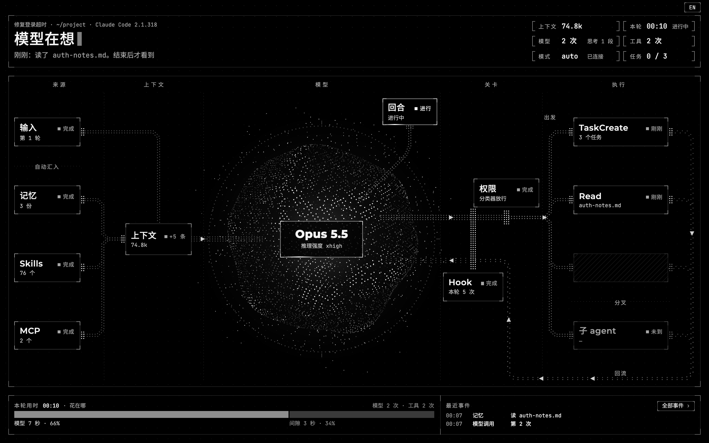
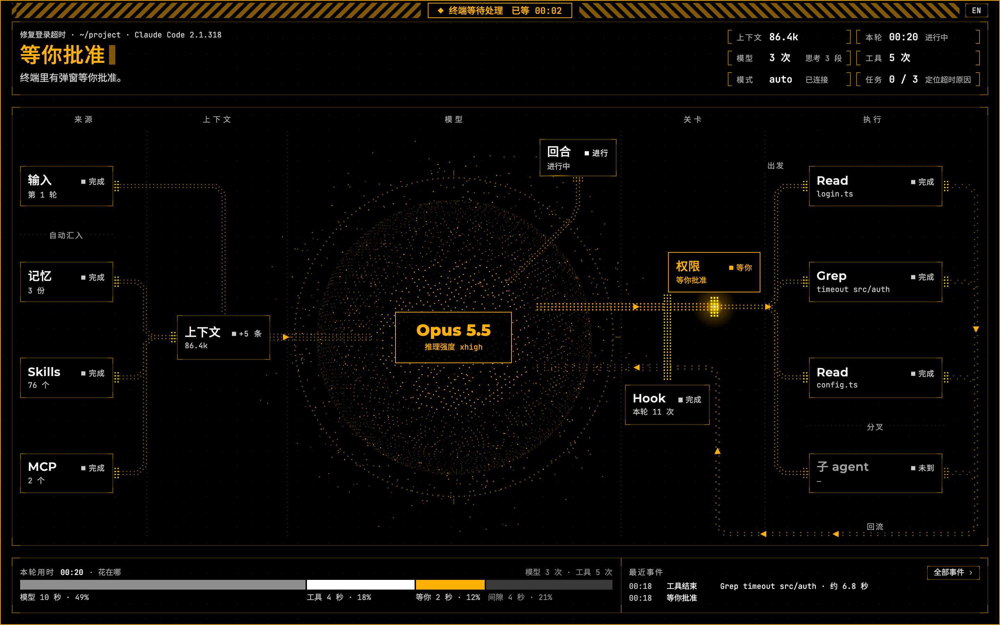
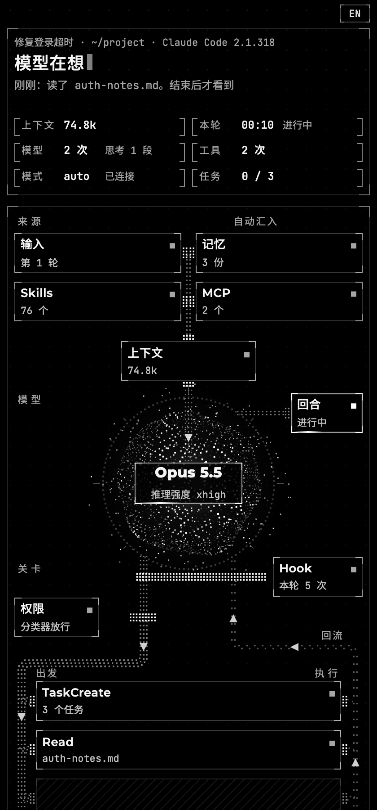

# harness-board

**实时看 Claude Code 此刻在做什么。** 在 Claude Code 会话里输入 `/harness-board`，浏览器会打开一个本机页面。Claude 干活时，页面上对应的那一步会亮起来：收到你的输入、组装上下文、调用模型、权限和 Hook 关卡、调用工具、派出子 agent，直到这一轮结束。

[English](README.md)



> 本说明里的截图都来自页面自带的演示回放，数据是编的。

## 页面上有什么

页面分上、中、下三块：

- **上：现在在做什么。** 用一句话说明此刻在做什么，比如「模型在想」「等你批准」「回合结束」。旁边有六格读数：上下文用量和压缩次数、本轮用时、模型调用次数、工具调用次数、权限模式和连接状态，用到任务清单时还会显示任务进度。
- **中：流转图。** 来源（你的输入，以及自动带进来的记忆、Skills、MCP）→ 上下文 → 模型 → 关卡（权限、Hook）→ 执行（工具、子 agent）。正在走的那条路上有粒子在流动。工具执行完会回到模型，计数会显示这是第几次回到模型。
- **下：记录。** 这一轮的时间花在了哪里（模型、工具、等你、间隙），以及最近的事件。点任意一张卡片或「全部事件」，右边会滑出抽屉显示明细。

颜色的意思是固定的：**琥珀色**表示在等你，比如终端里有批准弹窗；**红色**表示某一步没有照原样完成，可能是出错、被拒，或者你按了 Esc；**灰色、画面冻结**表示连接断开了，或者 Claude Code 已经退出。



窗口宽度分为超宽、常规、半屏、窄条四档，每档会重新排版，而不是整体缩小。右上角的按钮可以切换中英文，默认跟浏览器语言一致。



## 前提

- **macOS**，并且是**在终端里**运行的 Claude Code。Linux 也许能用，但没有测试过；Windows 不支持，脚本会直接退出。
- **Claude Code 2.1.69 或更新版本。** 记录解析已经对 Claude Code 2.1.258～2.1.322 核对过。
- **`python3` 3.9 或更新版本。** 只用到标准库，不需要 `pip install` 任何东西。如果 macOS 上没有 `python3`，运行 `xcode-select --install` 装上命令行工具即可。
- 一个浏览器。

**不支持** Claude 桌面应用或网页版的聊天界面，也不支持 Claude Code 的云端会话。看板读的是 Claude Code 在你本机写下的会话记录，这些地方在你本机上没有这份记录。

## 安装

```bash
git clone https://github.com/Zhiheng-07/harness-board.git
mkdir -p ~/.claude/skills
cp -R harness-board/harness-board ~/.claude/skills/
```

要拷的是**里面那一层** `harness-board` 文件夹，也就是包含 `SKILL.md` 的那个。装好后应该存在 `~/.claude/skills/harness-board/SKILL.md` 这个文件。

- 如果设置了 `CLAUDE_CONFIG_DIR`，改拷到 `"$CLAUDE_CONFIG_DIR/skills/"`。
- 也可以从 [Releases](https://github.com/Zhiheng-07/harness-board/releases) 下载 zip，解压后得到一个 `harness-board/` 文件夹，把它移到 `~/.claude/skills/` 下。每个发布都附有 zip 的 SHA-256 校验值。

装好后，新开一个 Claude Code 会话。

## 使用

| 要做什么 | 怎么做 |
|-|-|
| 打开看板 | 在 Claude Code 会话里输入 `/harness-board` |
| 停止看板 | `/harness-board stop` |
| Claude 正在干活时打开 | 干活期间输入的命令，要等这一轮结束后才会执行。想立刻看，就在**另一个终端**运行 `python3 ~/.claude/skills/harness-board/scripts/board.py pick`。它会列出正在运行的会话让你选；如果当前目录只有一个会话，就直接打开。这样做不消耗 token |
| 查看看板是否在运行 | `/harness-board status` |
| 不自动打开浏览器，只打印地址 | 加上 `--no-open` |

打开看板之后，照常使用 Claude Code 就行。再次输入 `/harness-board` 会沿用正在运行的那个看板。Claude Code 退出，或者没有页面打开且会话 30 分钟没有新动静时，看板会自己停止。在同一个终端里用 `/clear` 或 `/resume` 换了会话，看板会跟到新会话。

终端里的提示语言跟系统语言一致：macOS 上看系统设置里的首选语言，其他系统依次看 `LC_ALL`、`LC_MESSAGES`、`LANG`。想固定语言，就设置 `HARNESS_BOARD_LANG=zh` 或 `en`。

## 原理

```
Claude Code ──写入──▶ 会话记录（~/.claude/projects/…/<会话>.jsonl）
                      进程文件（~/.claude/sessions/<pid>.json）
                              │ 只读：每 0.1 秒读新增的记录，每 0.25 秒读一次进程状态
                              ▼
            board.py：跟读记录 → 解析 → 判断现在走到哪一步
                              │ 服务端推送，只在 127.0.0.1，随机端口加随机令牌
                              ▼
                          你的浏览器
```

- **只读。** 只读取 Claude Code 本来就会写的文件，不改 Claude Code 的设置，不用 Hook 或插件，也不代理 API 请求。
- **只在本机。** 服务只监听 127.0.0.1，端口随机，每个请求都要带随机令牌。页面不从网上加载任何东西：字体是内嵌的，Content-Security-Policy 设为 `default-src 'none'`。
- **体量小。** 只有一个 Python 脚本和一个 HTML 文件，没有任何依赖。

## 看不到的部分

Claude Code 的记录并不包含所有信息。看板只显示记录里有的，并说明哪些看不到。抽屉里的「看不到的部分」列出了这些内容：

1. **思考全文，以及模型正在输出的文字。** 要等这条消息结束才写进记录，实测最多晚 35 秒。
2. **不到约 3 秒就结束的工具。** 结束后才显示，卡片上标「刚刚」。
3. **批准弹窗和提问弹窗里的内容。** 有的版本要等你批准后，记录里才出现是哪个工具。
4. **放行或拒绝的原因。** 要等工具结束才知道。
5. **自动压缩的开始。** 记录里只有结束；手动 `/compact` 开始时就能看到。
6. **重试的原因。** 只看得到又发了一次请求。
7. **上下文窗口的上限。** 记录里没有这个数，所以只显示用量，不显示百分比。
8. **模型内部的决策，以及服务端发生的事。**

页面可能比实际慢几秒；很久没有新记录时，页面会明说。Claude Code 的记录格式是内部格式，每次升级都可能变。格式变了，页面可能显示得不全，并在会话信息后面加一句灰字提示，但不会白屏。

## 隐私和安全

- 所有数据都只在你的电脑上。页面会显示你的提问、文件名、路径和命令，共享屏幕时请留意。
- 看板的地址里带有令牌。浏览器正常打开时，终端里不会打印这个地址。用了 `--no-open`，或者浏览器没能打开时，地址会打印在终端里，也就会进入会话上下文。
- 令牌还会作为命令行参数传给后台进程，同一台电脑上的其他用户能在进程列表里看到它。

发现安全问题请看 [SECURITY.md](SECURITY.md)。

## 已知限制

- 打开或刷新页面时，看板会根据已有记录重建状态。在记录里，你在批准窗口点了「否」的工具和按 Esc 打断的工具写法一样，所以重建后都显示为「中断」。
- 启动时会把整份会话记录读进内存。140 MB 的记录，内存峰值约 490 MB。
- 请装在个人目录 `~/.claude/skills/` 下。装在别处没有测试过；路径里有空格时，启动命令很可能出错。
- 开着 Claude Code 的沙箱时，`/harness-board` 自己启动不了，见「排错」。

## 排错

| 现象 | 怎么办 |
|-|-|
| `/harness-board` 回复 `[shell command execution disabled by policy]`，或者脚本不让运行 | 你所在组织的统一管理设置，可能关掉了 skill 里的命令（`disableSkillShellExecution`），或者不认 skill 预先放行的命令（`allowManagedPermissionRulesOnly`）。改在终端里运行 `python3 ~/.claude/skills/harness-board/scripts/board.py pick` |
| 开着沙箱时，`/harness-board` 说没有权限访问 `~/.cache/harness-board/…` | Claude Code 的沙箱对 skill 里的命令也生效，只允许在工作目录里写文件。有两个办法：在另一个终端里运行 `python3 ~/.claude/skills/harness-board/scripts/board.py pick`；或者让这一条命令在沙箱外运行，把它的完整路径加进设置里的 `sandbox.excludedCommands`，例如 `"excludedCommands": ["python3 /Users/你的用户名/.claude/skills/harness-board/scripts/board.py *"]`。这个清单里的命令不受沙箱限制，确认能接受再这样做 |
| 页面一直显示「等待第一条记录」 | 新会话要等你发出第一条消息才会写下第一条记录，之后页面会自动跟上 |
| `python3: command not found` | 运行 `xcode-select --install` 安装命令行工具 |
| 终端里有弹窗，页面却一直显示「模型在想」 | 「在等你」这个状态是从 `~/.claude/sessions/<pid>.json` 读到的。读不到这个文件时，标题会写明，中间和下面两块也会变灰 |

## 卸载

先在每个打开了看板的会话里运行 `/harness-board stop`，然后执行：

```bash
rm -rf ~/.claude/skills/harness-board ~/.cache/harness-board
```

## 仓库结构

```
harness-board/        skill 本体，把这个文件夹拷进 ~/.claude/skills/
  SKILL.md            /harness-board 命令
  scripts/board.py    命令行和本地服务
  scripts/cc_records.py  记录解析和状态机
  scripts/pointer_check.py  开发时用的打包自检，运行时用不到
  assets/board.html   页面（单文件，字体内嵌）
  assets/字体授权/     字体授权
  LICENSE
tests/                测试，用的是合成记录：python3 tests/test_cc_records.py；python3 tests/test_board.py
docs/images/          截图
```

## 许可证

MIT，见 [LICENSE](LICENSE)。`board.html` 里内嵌的字体（Montserrat、JetBrains Mono、思源黑体 Noto Sans SC）不在 MIT 范围内，它们按 SIL Open Font License 1.1 授权，见 `harness-board/assets/字体授权/`。

这是个人项目，不是 Anthropic 官方出品，和 Anthropic 没有关联。Claude 和 Claude Code 是 Anthropic 的商标。
